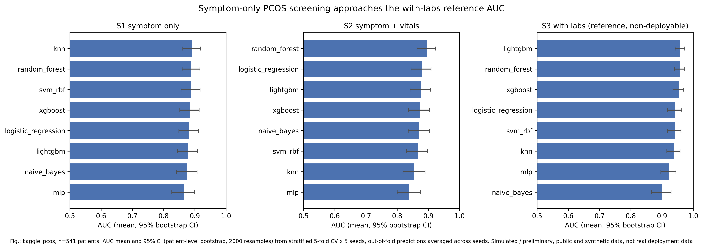

# MyCycle

**Private menstrual health screening that learns one person's own baseline, runs on the phone, and speaks three languages.**

[](#status-and-honest-limits)
[](#privacy-is-the-architecture)
[](#multilingual-by-default)
[](#this-is-not-a-diagnostic-tool)

Most cycle apps compare a person against a population average: anything outside 21 to 35 days is "irregular".
That is a weak signal. A 24-day cycle is perfectly normal for one person and a warning sign for another whose
cycles have always run at 31 days. The information is in the *change from your own baseline*, not in the
distance from a population mean.

MyCycle learns what is normal for one individual, flags departures from that personal baseline that may be
worth a doctor's attention, keeps every raw log on the device, and explains what it found in English, Hindi or
Marathi, with audio for users who would rather listen than read.

---

## This is not a diagnostic tool

The output is a **screening flag**, never a medical conclusion. Every flag the app raises is phrased as a
suggestion to talk to a clinician, and that language is enforced in code by a linter over the message
catalogue (`scripts/lint_language.py`), not left to the discretion of whoever writes the copy. No part of this
project is a medical device, and nothing here has been clinically validated.

---

## Privacy is the architecture

Menstrual data is among the most sensitive data a person has, and in several jurisdictions it has been
subpoenaed. So privacy here is a structural property, not a setting:

| Design decision | What it means in practice |
|---|---|
| Raw cycle and symptom logs never leave the device | There is no server copy to leak, subpoena or sell |
| Inference runs on-device | The model is exported to ONNX and runs locally; a test asserts the exported model matches PyTorch to within 1e-4 |
| Works offline after first load | The screening does not depend on a network round-trip |
| Measured egress, not promised egress | A network counter plus tests assert the app sent **0 bytes** of user data |
| Voice logging is local | Audio is transcribed on the device and not stored |
| Family sharing shares a phase, not a log | The only thing that can be shared is a coarse cycle phase |
| Disguise mode | The app can be made to not look like a cycle tracker on a shared phone |
| Doctor-visit card is generated locally | A summary to show a clinician is produced on-device and uploaded nowhere |

Where a federated design is used for model improvement, it is differential-privacy-aware by construction, and
raw records never form part of an update.

---

## Results

Two of the three evaluations use **real public data**; the drift-detection evaluation uses a **cycle simulator**,
because no public dataset contains labelled per-person baseline drift. Each is labelled below. Every AUC carries
a bootstrap 95% confidence interval, and model comparisons use a paired bootstrap rather than eyeballing.

### Screening from symptoms alone: Kaggle PCOS dataset (real data)

| Feature set | Best model | AUC | 95% CI |
|---|---|---:|---|
| Symptoms only *(what a phone can actually collect)* | k-NN | **0.891** | 0.862 to 0.918 |
| Symptoms only | random forest | 0.889 | 0.860 to 0.916 |
| Symptoms only | SVM (RBF) | 0.887 | 0.856 to 0.917 |
| Symptoms only | logistic regression | 0.882 | 0.849 to 0.912 |
| **With labs and ultrasound** *(reference only, not deployable on a phone)* | n/a | **~0.96** | n/a |

The top two symptom-only models are **not** significantly different (paired bootstrap, p = 0.82), so the
simplest adequate model wins rather than the most impressive-sounding one. Symptom-only screening retains most,
but not all, of the accuracy available with clinical labs, and the gap is stated rather than hidden.

### Screening on real national survey data: NFHS-5

| Target | Feature set | Best AUC | Verdict |
|---|---|---:|---|
| Self-reported thyroid condition | symptoms + vitals | **0.768** | Significantly better than the next model (p = 0.024) |
| Anaemia (WHO haemoglobin threshold) | symptoms + demographics | **0.62** | **Near chance, a negative result reported as one** |

The anaemia result is the most useful number in this project. Symptom self-report does not predict
haemoglobin-defined anaemia at a usable accuracy, so MyCycle does not claim to screen for anaemia. A project
that only published the 0.89 would have been a worse piece of research.

### Personal-baseline drift detection (cycle simulator, synthetic users)

Detectors are tuned on a validation split only, then measured once on held-out simulated users.

| Detector | PCOS pattern | Anaemia pattern | Thyroid pattern | False alarms per 100 normal cycles |
|---|---:|---:|---:|---:|
| Tier 1 hybrid (z-score + CUSUM + rules) | **99%** | **92%** | **99%** | 4.3 |
| Fixed population threshold *(what most apps do)* | 100% | 99% | 85% | 3.4 |
| CUSUM alone | n/a | n/a | n/a | lowest |
| Tier 2 GRU (hidden size 32) | 85% | 48% | 27% | n/a |

**The honest reading of this table:** the naive population threshold is a *strong* baseline. It matches or beats
the hybrid detector on two of three patterns and raises slightly fewer false alarms overall. Where the
personal-baseline approach does win is in who gets flagged: the fixed threshold flags **33%** of healthy
simulated users at least once, the hybrid **28%**, and CUSUM alone **13%**. For a screening tool, the cost of
frightening a healthy person is the thing to minimise.

The GRU is **not** clearly better than plain exponential smoothing at this task and is worse than the Tier 1
hybrid, so it is kept as a second tier rather than promoted to the main detector. Personalising it (fine-tuning
only the output head on a user's first four cycles) raises detection substantially, thyroid pattern from 11% to
67%, but raises false alarms from 0.8% to 18.6% of non-drift cycles, which is why it is not on by default.

---

## Every claim is tied to evidence

The project runs on a rule borrowed from research practice: **no entry, no claim.** Every assertion that appears
in the app, the paper, the slides or the poster has a row in [`docs/CLAIMS_EVIDENCE.md`](docs/CLAIMS_EVIDENCE.md)
recording its exact wording, where it appears, whether it is measured / cited / interviewed / a design decision,
a pointer to the evidence, its status, and an owner. A claim cannot ship while its status is `needs work`.

That table also records corrections. One row documents a false-alarm figure that was originally attributed to the
wrong detector and was corrected on 2026-09-29, and kept visible in the file rather than quietly edited out.

A checker enforces this: `python scripts/check.py --strict` fails the build while any placeholder result remains.

---

## Multilingual by default

Explanations are generated in **English, Hindi and Marathi**, with audio. This is not a translation layer bolted
on at the end. The message catalogue is the source of truth, the language linter runs over every locale, and the
non-diagnostic phrasing must hold in all three languages.

---

## Status and honest limits

This is a **research prototype and an academic paper**, not a product, and not a medical device.

- Nothing here is clinically validated. The outputs are screening flags for conversation with a clinician.
- The drift-detection numbers come from a **cycle simulator**, not from real users with labelled conditions.
- The PCOS result comes from a Kaggle dataset whose population may not generalise to Indian users at large.
- Anaemia screening from symptoms **does not work** at usable accuracy, and the app does not offer it.
- The federated-learning component is designed and implemented but **its evaluation has not been run**, so there
  are no federated numbers in this README because there are no trustworthy federated numbers yet.
- The on-device latency and memory figures are not yet measured on a representative low-end device.

---

## Repository map

| Path | What lives there |
|---|---|
| `app/` | The on-device application |
| `data/` | Dataset download scripts (Kaggle PCOS, NFHS-5, cycle calibration) and `DATA_REGISTER.md` |
| `results/` | Measured results as JSON, with figures and tables; schema-checked |
| `docs/CLAIMS_EVIDENCE.md` | Every claim, its evidence pointer, its status and its owner |
| `docs/PRODUCT_OVERVIEW.md` | What the product does and for whom |
| `demo/` | Demo page, logging form, speaker script, product abstract |
| `content/` | Message catalogue per locale, plus audio |
| `scripts/` | `check.py`, `check_slides.py`, `lint_language.py` |
| `tests/` | Including the ONNX / PyTorch parity test |



## Running it

```bash
pip install -r requirements-dev.txt
python scripts/check.py            # must be green before every push
python scripts/check.py --strict   # also fails on any remaining placeholder result
```

Datasets are not committed. Fetch them with the scripts in `data/`; `data/DATA_REGISTER.md` records the
provenance and licence of each one.

---

## Team and context

Built for **216U50P501 Community Engagement Project with Design Thinking**, K. J. Somaiya School of Engineering.
Guide: **Dr. Makarand G. Kulkarni**.

| | |
|---|---|
| **Aryan Lomte** | Modelling and evaluation: classifiers, drift detectors, sequence models, ONNX export, results pipeline |
| **Liza** | Privacy architecture and measured egress, offline behaviour, disguise mode, app privacy surfaces |
| **Aditya** | Non-diagnostic message catalogue and language enforcement |
| **Saanj** | Claims-evidence table and research write-up |
